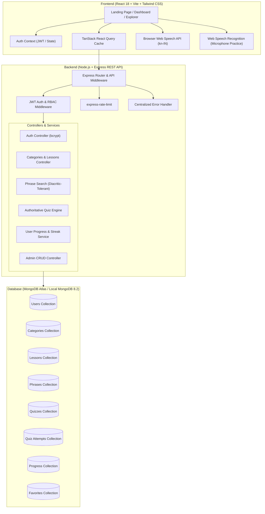
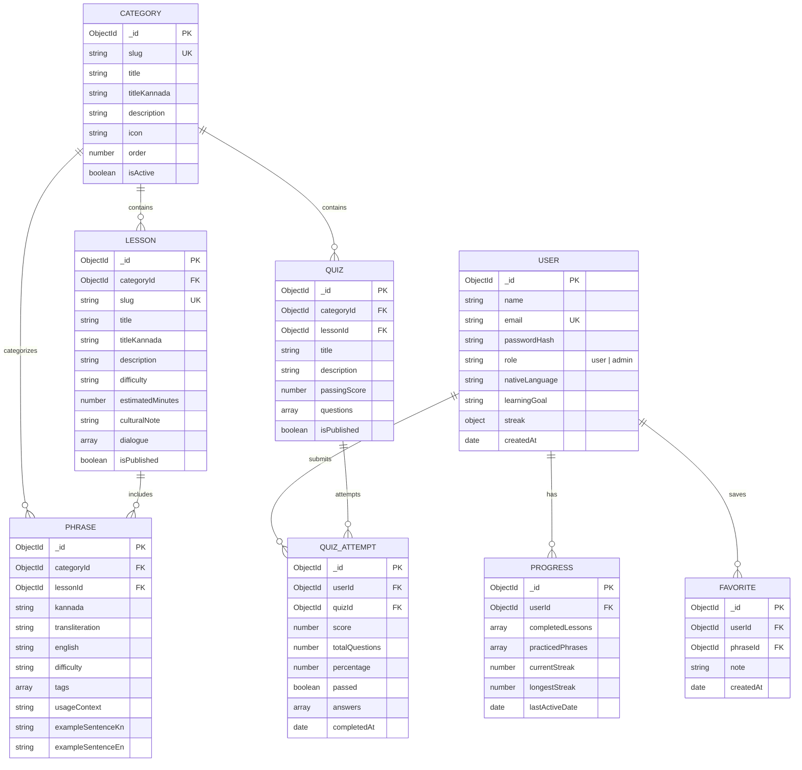

# KannadaConnect — Full-Stack Kannada Learning Platform
> **Kannada Technology Challenge** · Problem Statement: **“Kannada for Everyone”**

[](#testing-and-verification)
[](#testing-and-verification)
[](#database-design)
[](#technology-stack)
[-green)](#technology-stack)

---

## 1. Project Overview

**KannadaConnect** is an accessible, modern, full-stack educational web application designed to help non-Kannada speakers learn and practice conversational Kannada in everyday situations.

The platform guides learners through real-life scenarios—such as hailing an auto-rickshaw in Bengaluru, asking bus conductors for stops, ordering food at a Darshini restaurant, bargaining at vegetable markets, explaining symptoms at a pharmacy, and greeting neighbours respectfully.

---

## 2. Problem Statement: “Kannada for Everyone”

In a rapidly growing, cosmopolitan state like Karnataka, millions of non-native students, IT professionals, healthcare workers, and migrants encounter linguistic and cultural barriers in daily interactions. Existing language resources often suffer from:
- Academic grammar-heavy approaches that lack situational relevance.
- Static, frontend-only phrase lists without audio, authentication, persistence, or guided practice.
- Lack of authoritative feedback or progress tracking across devices.

**KannadaConnect** solves this by providing situation-first learning modules with authentic Kannada script, English transliteration, cultural context notes, browser text-to-speech, interactive active recall flashcards, and an authoritative quiz system backed by MongoDB Atlas.

---

## 3. Target Users

- **Relocated Professionals & Students:** New residents moving to Bengaluru, Mysuru, Hubballi, or Mangaluru who need functional everyday communication.
- **Tourists & Travelers:** Visitors navigating Karnataka's heritage sites, public transit, and culinary hubs.
- **Service Workers & Business Owners:** People seeking courteous, respectful dialogue with local customers and vendors.
- **Heritage & Diaspora Learners:** Families wanting to reconnect with Kannada language and Karnataka culture.

---

## 4. Existing System Limitations & Evolution

The project originally started as a static single-page prototype (`index.html`) storing progress only in browser `localStorage`. While functional as a starter concept, it had fundamental limitations:
1. **Frontend-Only Persistence:** Clearing browser history or switching devices lost all progress.
2. **No User Accounts or Security:** Anyone could inspect quiz answer keys in client-side JavaScript.
3. **Limited Content Set:** Only 20 phrases across 5 categories with no lesson progression.
4. **No Administrative Management:** No ability for educators to publish or update curriculum without editing source code.

### KannadaConnect's Full-Stack Solution:
- Migrated to a component-driven **React + Vite** frontend with Tailwind CSS and TanStack React Query.
- Built a secure **Node.js + Express** REST API using native ES modules.
- Integrated **MongoDB Atlas** for persistent storage of users, categories, lessons, phrases, quiz attempts, and favorites.
- Designed an **authoritative quiz evaluation engine** that strips answers before serving questions to learners and computes authoritative scores on the backend.
- Implemented **Role-Based Access Control (RBAC)** for admin curriculum management.

---

## 5. System Architecture



---

## 6. Implemented Features

### A. Landing Page & Educational Branding
- Warm Karnataka-inspired color scheme (amber/orange `#E87532`, forest green `#237A57`, cream `#FFFAF1`).
- Hero section with large typography (`ನಮಸ್ಕಾರ`), audio demo, and situation overview.
- 10 situation-based category cards with lesson and phrase counts.
- Interactive starter phrase preview with Web Speech playback.

### B. User Authentication & Security
- Secure registration and login with bcrypt password hashing (salt rounds = 10).
- Session management using **HttpOnly cookies** (`kc_token`) with Bearer header fallback.
- Centralized token verification middleware (`requireAuth`, `optionalAuth`, `requireAdmin`).
- Profile management with password updates and learning goal customization.

### C. Kannada Learning Dashboard
- Real-time learner metrics retrieved from MongoDB:
  - Daily learning streak counter.
  - Course completion percentage.
  - Phrase practice coverage.
  - Authoritative quiz scores (average and best score).
  - Recommended next lesson based on incomplete items.
  - Empty state with onboarding recommendations for new learners.

### D. 10 Structured Situation Tracks
1. **Kannada Basics (ಕನ್ನಡ ಮೂಲಗಳು):** Foundation sounds and polite affirmations.
2. **Greetings & Introductions (ಶುಭಾಶಯಗಳು ಮತ್ತು ಪರಿಚಯ):** Universal greetings, names, and courtesy.
3. **Everyday Conversations (ದೈನಂದಿನ ಸಂಭಾಷಣೆಗಳು):** Checking in with neighbours and friends (`ಊಟ ಆಯ್ತಾ?`).
4. **Travel & Transportation (ಪ್ರಯಾಣ ಮತ್ತು ಸಾರಿಗೆ):** BMTC bus stands, metro directions, auto meter requests (`ಮೀಟರ್ ಹಾಕಿ`).
5. **Shopping & Payments (ಖರೀದಿ ಮತ್ತು ಪಾವತಿಗಳು):** Market bargaining (`ಸ್ವಲ್ಪ ಕಡಿಮೆ ಮಾಡಿ`) and UPI questions (`ಗೂಗಲ್ ಪೇ ಇದೆಯಾ?`).
6. **Food & Restaurants (ಆಹಾರ ಮತ್ತು ಉಪಹಾರ ಗೃಹಗಳು):** Ordering dosas and filter coffee at Darshinis, requesting less spice.
7. **Healthcare & Emergencies (ಆರೋಗ್ಯ ಮತ್ತು ತುರ್ತು ಸಂದರ್ಭಗಳು):** Explaining fever, pain, and pharmacy instructions.
8. **Education & Workplace (ಶಿಕ್ಷಣ ಮತ್ತು ಕೆಲಸದ ಸ್ಥಳ):** Clarification requests (`ದಯವಿಟ್ಟು ಮತ್ತೆ ಹೇಳಿ`), office courtesy.
9. **Numbers, Dates & Time (ಸಂಖ್ಯೆಗಳು, ದಿನಾಂಕಗಳು ಮತ್ತು ಸಮಯ):** Cardinal numbers, time queries (`ಈಗ ಸಮಯ ಎಷ್ಟು?`), scheduling.
10. **Culture & Etiquette (ಕನ್ನಡ ಸಂಸ್ಕೃತಿ ಮತ್ತು ಶಿಷ್ಟಾಚಾರ):** Karnataka Rajyotsava, respectful suffixes, cultural harmony.

### E. Searchable Phrase Explorer & Audio
- Full text search across Kannada script, English meaning, and transliteration.
- **Diacritic-Tolerant Search:** Plain English inputs like `Namaskara` or `Dhanyavadagalu` match accented transliterations like `Namaskāra` and `Dhanyavādagaḷu`.
- Category and difficulty filters with pagination.
- One-click Web Speech audio playback (`kn-IN`).
- Live pronunciation practice modal using browser `SpeechRecognition` with microphone permission handling.
- Personal bookmarks toggle (Favorites).

### F. Interactive Active Recall Flashcards
- Card flip reveals English meaning and pronunciation transliteration.
- Keyboard navigation (Space/Enter to flip, arrow keys to navigate).
- "Practised ✓" button synchronizes practice count directly to MongoDB progress.
- Category filtering and deck shuffle.

### G. Authoritative Quiz System
- Questions with multiple-choice, vocabulary translation, and phrase completion.
- **Anti-Cheat Architecture:** Answers are stripped on question retrieval; grading occurs exclusively on the backend (`POST /api/quizzes/:id/attempts`).
- Comprehensive score breakdown with percentage, pass/fail status, and question explanations.
- Attempt history logged per learner.

### H. Administrator Dashboard (RBAC)
- Role-protected access (`/admin`) enforcing `requireAdmin` middleware.
- Platform statistics: total registered learners, situation tracks, lessons, phrases, and quiz attempts.
- Interactive CRUD management for tracks and phrases.
- Learner role management (`user` ↔ `admin`).

---

## 7. Technology Stack

| Layer | Technologies |
| :--- | :--- |
| **Frontend** | React 18, Vite, React Router 6, Tailwind CSS, TanStack React Query 5, React Hook Form, Lucide React, Axios |
| **Backend** | Node.js (v22+), Express.js (ES Modules), Mongoose 8, JWT, bcryptjs, cookie-parser, helmet, morgan, express-rate-limit |
| **Database** | MongoDB Atlas / Local MongoDB 8.2 |
| **Speech APIs**| Web Speech API (`SpeechSynthesisUtterance`, `SpeechRecognition`) |
| **Testing** | Vitest (Backend & Frontend), Supertest, React Testing Library, jsdom |

---

## 8. Database Design



---

## 9. Project Directory Structure

```text
kannadaconnect/
├── index.html                   # Original preserved static prototype
├── package.json                 # Root workspace orchestration scripts
├── .env.example                 # Root workspace environment template
├── .gitignore                   # Comprehensive version control ignore rules
├── docs/
│   ├── API_DOCUMENTATION.md     # Full REST API endpoint reference
│   └── explanation-video-script.md # Voice-over video demo script
├── server/
│   ├── package.json             # Express & Node backend dependencies
│   ├── .env.example             # Backend environment template
│   ├── .env                     # Local backend environment
│   ├── src/
│   │   ├── config/
│   │   │   ├── env.js           # Environment configuration loader
│   │   │   └── db.js            # Mongoose MongoDB connection manager
│   │   ├── models/              # Mongoose schemas & validation
│   │   │   ├── User.js
│   │   │   ├── Category.js
│   │   │   ├── Lesson.js
│   │   │   ├── Phrase.js
│   │   │   ├── Quiz.js
│   │   │   ├── QuizAttempt.js
│   │   │   ├── Progress.js
│   │   │   └── Favorite.js
│   │   ├── middleware/
│   │   │   ├── authMiddleware.js # requireAuth, optionalAuth, requireAdmin
│   │   │   ├── errorMiddleware.js# Centralized error & 404 handler
│   │   │   └── rateLimiter.js   # API & auth rate limiters
│   │   ├── controllers/         # Business logic & request handling
│   │   │   ├── authController.js
│   │   │   ├── categoryController.js
│   │   │   ├── lessonController.js
│   │   │   ├── phraseController.js
│   │   │   ├── quizController.js
│   │   │   ├── progressController.js
│   │   │   ├── favoriteController.js
│   │   │   └── adminController.js
│   │   ├── routes/              # Express REST routes
│   │   ├── validators/          # Request validation middleware
│   │   ├── utils/
│   │   │   ├── jwt.js           # JWT & HttpOnly cookie helpers
│   │   │   ├── seedData.js      # Structured curriculum seed definitions
│   │   │   └── seed.js          # Database populator & demo accounts
│   │   ├── app.js               # Express application configuration
│   │   └── server.js            # Server entry point & graceful shutdown
│   └── tests/
│       └── api.test.js          # 15 backend Vitest + Supertest suites
└── frontend/
    ├── package.json             # React 18 & Vite dependencies
    ├── vite.config.js           # Vite + proxy + Vitest configuration
    ├── tailwind.config.js       # KannadaConnect color & typography theme
    ├── postcss.config.js
    ├── index.html               # Responsive HTML root with Noto Sans Kannada
    ├── .env.example
    ├── .env
    └── src/
        ├── api/                 # Axios clients for REST endpoints
        ├── context/             # AuthContext provider
        ├── components/          # Navbar, Footer, AudioButton, PhraseCard, Flashcard, etc.
        ├── pages/               # LandingPage, Dashboard, Tracks, Explorer, Quizzes, Admin
        ├── utils/               # Web Speech synthesis & recognition helpers
        ├── tests/               # React Testing Library unit tests
        ├── App.jsx              # Application router
        ├── main.jsx             # React entry point
        └── index.css            # Tailwind & Kannada font utilities
```

---

## 10. Windows 11 Step-by-Step Setup Guide

This application is fully tested and compatible with **Windows 11** using PowerShell or Command Prompt.

### Step 1: Verify Node.js and npm
Open PowerShell or Command Prompt and run:
```powershell
node -v
npm.cmd -v
```
*(Recommended: Node.js v18, v20, or v22).*

> **Tip for Windows PowerShell Execution Policy:**
> If running scripts is restricted on your system, use `npm.cmd` instead of `npm`, or run:
> ```powershell
> Set-ExecutionPolicy -Scope Process -ExecutionPolicy Bypass
> ```

### Step 2: Open the Project Directory
```powershell
cd C:\Users\arnab\Downloads\Kannada\kannadaconnect
```

### Step 3: Install Dependencies
You can install dependencies for both frontend and backend using the root command:
```powershell
npm.cmd run install:all
```
*Or individually:*
```powershell
cd server
npm.cmd install
cd ..\frontend
npm.cmd install
cd ..
```

### Step 4: Configure Environment Variables
Copy the template files if creating fresh environments:
```powershell
Copy-Item server\.env.example server\.env
Copy-Item frontend\.env.example frontend\.env
```

### Step 5: Start MongoDB and Seed Data
Ensure MongoDB is running locally (e.g. `mongod` service on Windows) or point `MONGODB_URI` in `server/.env` to your **MongoDB Atlas** connection string.

Run the seed script to populate all 10 tracks, authentic phrases, and evaluation accounts:
```powershell
npm.cmd run seed
```

Default credentials created by seeder:
| Account | Email | Password | Role |
| :--- | :--- | :--- | :--- |
| **Administrator** | `admin@kannadaconnect.org` | `Admin@12345` | `admin` |
| **Demo Learner** | `learner@kannadaconnect.org` | `Learner@12345` | `user` |

### Step 6: Start Development Servers
Open two terminal windows:

**Terminal 1 (Backend Server on port 5000):**
```powershell
cd server
npm.cmd run dev
```

**Terminal 2 (Frontend Client on port 5173):**
```powershell
cd frontend
npm.cmd run dev
```

Open **`http://localhost:5173`** in Google Chrome or Microsoft Edge.

---

## 11. Testing and Verification

Run the automated test suites:

### Run All Tests (Root):
```powershell
npm.cmd test
```

### Backend API Tests Only:
```powershell
cd server
npm.cmd test
```
*Executes 15 comprehensive tests covering:*
- Health check and DB status
- User registration, duplicate email rejection, and bcrypt authentication
- Protected profile endpoints (`/api/auth/me`)
- Situation tracks and lesson retrieval
- Diacritic-tolerant phrase search (`Namaskara` → `ನಮಸ್ಕಾರ`)
- Anti-cheat question delivery and authoritative quiz attempt scoring
- Learning progress and favorite bookmarks
- RBAC authorization check (verifies regular learners receive `403 Forbidden` on `/api/admin/*`)

### Frontend Unit Tests Only:
```powershell
cd frontend
npm.cmd test
```
*Executes React Testing Library tests for:*
- `AudioButton` rendering and Web Speech synthesis triggers.
- `PhraseCard` Kannada script, transliteration, and meaning display.
- `Flashcard` active recall flip and revelation interactions.

---

## 12. Production Build and Deployment

### Production Build
To create a production-optimized frontend bundle:
```powershell
npm.cmd run build
```
The output is generated in `frontend/dist/`.

### Deployment Guide
1. **Database:** Deploy a free cluster on **MongoDB Atlas**.
   - Create a database user and configure Network Access (`0.0.0.0/0` or Render/Vercel IP ranges).
   - Obtain connection string: `mongodb+srv://<user>:<password>@cluster0.mongodb.net/kannadaconnect?retryWrites=true&w=majority`.
2. **Backend (Render / Railway / Fly.io):**
   - Root directory: `server/`
   - Build command: `npm install`
   - Start command: `node src/server.js`
   - Environment variables: `NODE_ENV=production`, `PORT=5000`, `MONGODB_URI`, `JWT_SECRET`, `CLIENT_URL=https://your-frontend.vercel.app`.
3. **Frontend (Vercel / Netlify):**
   - Root directory: `frontend/`
   - Build command: `npm run build`
   - Output directory: `dist`
   - Environment variables: `VITE_API_URL=https://your-backend.onrender.com/api`.

---

## 13. Security Considerations

- **No Plaintext Passwords:** Passwords are never stored in plaintext and are hashed with bcrypt.
- **Cookie Security:** Auth tokens are set with `HttpOnly`, `SameSite`, and `Secure` (in production).
- **Rate Limiting:** Global rate limiting protects all `/api/*` endpoints; dedicated rate limiting (`authLimiter`) restricts brute-force attempts on registration and login.
- **Anti-Cheat Quizzing:** Answer keys (`correctAnswerId`) and explanations are explicitly excluded from question queries and are only revealed upon authoritative backend grading.
- **Sanitized Responses:** Centralized error handling strips database error details and stack traces in production mode.
- **No Committed Secrets:** `.env` is git-ignored, and `.env.example` contains only placeholder values.

---

## 14. Known Limitations & Future Enhancements

- **Speech Synthesis Voice:** Voice quality depends on whether a Kannada voice (`kn-IN`) is installed on the user's browser or device. When unavailable, the interface displays a clear notification.
- **Native Audio Recordings:** Future releases will incorporate studio recordings by native Kannada speakers alongside browser synthesis.
- **Expanded Dialects:** Future scope includes regional dialects from North Karnataka (Hubballi-Dharwad), Coastal Karnataka (Mangaluru/Tuluva Kannada), and Mysuru Kannada.
- **Offline PWA:** Progressive Web App capabilities for offline practice during transit.

---

## 15. Contributor & Event Details

- **Event:** Kannada Technology Challenge
- **Problem Statement:** Kannada for Everyone
- **Project Name:** KannadaConnect
- **Team / Developer:** Full-Stack Pair Programming Deliverable
- **Submission Date:** October 2026

*ಸಿರಿಗನ್ನಡಂ ಗೆಲ್ಗೆ, ಸಿರಿಗನ್ನಡಂ ಬಾಳ್ಗೆ! (Long live glorious Kannada!)*
